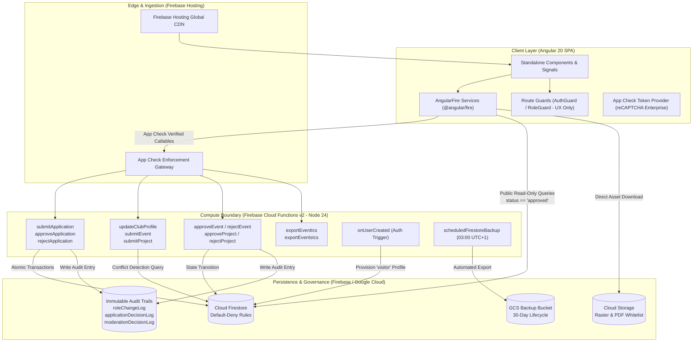

<div align="center">

<p align="center">
  
</p>

# NACS Platform (National Association of Campus Societies)
### Interconnecting Algerian University Societies Across 58 Wilayas
**Developed by Google Developer Groups on Campus USTO-MB**

[](https://github.com/sirgio03/NACS-BETA/actions/workflows/ci.yml)
[](https://nodejs.org)
[](https://angular.dev)
[](https://firebase.google.com)
[]()

<p align="center">
  Production-grade web platform and administrative governance portal for the <b>National Association of Campus Societies (NACS)</b>, interconnecting university student societies, tech clubs, and academic chapters across Algeria's 58 wilayas.
</p>

</div>

---

## Table of Contents

- [1. Executive Overview & Architecture](#1-executive-overview--architecture)
  - [Core Architectural Invariants](#core-architectural-invariants)
  - [High-Level System Architecture](#high-level-system-architecture)
- [2. Problem Formulation: GDG on Campus USTO-MB & Algerian Students](#2-problem-formulation-gdg-on-campus-usto-mb--algerian-students)
  - [Regional Isolation & Inter-Campus Communication Fragmentation](#regional-isolation--inter-campus-communication-fragmentation)
  - [Event Cannibalization & The ±3-Day Conflict Problem](#event-cannibalization--the-3-day-conflict-problem)
  - [Post-Hackathon Project Oblivion & Talent Discovery](#post-hackathon-project-oblivion--talent-discovery)
  - [Institutional Governance & Verified Society Credentials](#institutional-governance--verified-society-credentials)
  - [Engineering Sandbox for Student Developers](#engineering-sandbox-for-student-developers)
- [3. Repository Directory Tree](#3-repository-directory-tree)
- [4. Prerequisites & Environment Configuration](#4-prerequisites--environment-configuration)
  - [Local System Prerequisites](#local-system-prerequisites)
  - [Environment Variables Mapping (.env.example)](#environment-variables-mapping-envexample)
  - [Environment Provisioning Script](#environment-provisioning-script)
- [5. Step-by-Step Local Setup & Execution Guide](#5-step-by-step-local-setup--execution-guide)
  - [Step 1: Clone and Dependencies Installation](#step-1-clone-and-dependencies-installation)
  - [Step 2: Environment File Generation](#step-2-environment-file-generation)
  - [Step 3: Launching the Firebase Local Emulator Suite](#step-3-launching-the-firebase-local-emulator-suite)
  - [Step 4: Launching the Angular Frontend](#step-4-launching-the-angular-frontend)
- [6. Testing & Quality Assurance](#6-testing--quality-assurance)
  - [Frontend Unit Tests](#frontend-unit-tests)
  - [Firestore Security Rules Behavioral Testing](#firestore-security-rules-behavioral-testing)
  - [Cloud Functions Integration Testing](#cloud-functions-integration-testing)
  - [Build Validation](#build-validation)
- [7. Security Model & Data Governance](#7-security-model--data-governance)
  - [Role-Based Access Control (RBAC)](#role-based-access-control-rbac)
  - [Storage Security Policy](#storage-security-policy)
  - [Immutable Audit Logging](#immutable-audit-logging)
  - [Disaster Recovery & Automated Exports](#disaster-recovery--automated-exports)
- [8. Contribution Conventions for Student Developers](#8-contribution-conventions-for-student-developers)
  - [Branch Naming Standard](#branch-naming-standard)
  - [Commit Message Protocol (Conventional Commits)](#commit-message-protocol-conventional-commits)
  - [Pull Request (PR) Workflow & Checklist](#pull-request-pr-workflow--checklist)
  - [CI/CD Deployment Lifecycle](#cicd-deployment-lifecycle)

---

## 1. Executive Overview & Architecture

The NACS Platform provides an authoritative digital infrastructure for Algerian university campus societies. It centralizes verified club directories, an interactive 58-wilaya national reach map, an automated conflict-detected national event calendar, a student technical project showcase, and a multi-tiered administrative governance portal.

### Core Architectural Invariants

1. **Standalone Angular Architecture with Signals**: Built with Angular 20 standalone components (`standalone: true`) utilizing Angular Signals and reactive Services for UI state management without external store overhead ([ADR 001](docs/DECISIONS.md#adr-001-standalone-angular-architecture--signal-driven-state-management)).
2. **Server-Side Mutation Boundary**: Client applications operate under a strict **default-deny** security regime (`match /{document=**} { allow read, write: if false; }`). All state mutations—application submissions, event creation, showcase submissions, role promotions, and moderation actions—are executed through HTTPS Callable Cloud Functions using the Firebase Admin SDK ([ADR 003](docs/DECISIONS.md#adr-003-server-side-mutation-boundary--default-deny-firestore-security-rules)).
3. **Bot Mitigation via Firebase App Check**: Public submission endpoints are protected by Firebase App Check enforced with reCAPTCHA Enterprise tokens ([ADR 004](docs/DECISIONS.md#adr-004-callable-application-submission-with-firebase-app-check)).
4. **Dual-Environment Isolation**: Complete logical and physical separation between staging (`nacs-platform-staging`) and production (`nacs-platform-prod`), governed by `.firebaserc` and dynamic code generation scripts ([ADR 002](docs/DECISIONS.md#adr-002-dual-environment-separation-with-zero-secret-policy)).
5. **Zero-Secret Source Control Policy**: API secrets, private service account keys, and reCAPTCHA production keys are strictly prohibited from Git history. Configuration is hydrated via environment templates and GitHub Actions secrets.

### High-Level System Architecture



---

## 2. Problem Formulation: GDG on Campus USTO-MB & Algerian Students

The platform directly addresses the structural, logistical, and technical challenges faced by student tech organizations like **Google Developer Groups (GDG) on Campus USTO-MB** (*Université des Sciences et de la Technologie d'Oran Mohamed-Boudiaf*) and academic societies across Algerian universities.

### Regional Isolation & Inter-Campus Communication Fragmentation
- **The Challenge**: Student societies across Algeria (e.g., Oran Wilaya 31, Algiers Wilaya 16, Constantine Wilaya 25, Béjaïa Wilaya 06) historically operated in silos. Information about upcoming bootcamps, speaker sessions, and hackathons was trapped within ephemeral social media posts or fragmented private Telegram/Discord groups.
- **NACS Solution**: Provides an authoritative, centralized directory of verified university societies and an interactive 58-Wilaya map (`WilayaMapService`). Students at USTO-MB can instantly identify active clubs, verify institutional affiliation, and collaborate on national initiatives.

### Event Cannibalization & The ±3-Day Conflict Problem
- **The Challenge**: When GDG on Campus USTO-MB plans a major tech summit or Solution Challenge hackathon, overlapping dates with another major tech club in Oran or a neighboring wilaya split participant bandwidth, guest speaker availability, and university sponsor support.
- **NACS Solution**: Implements automated **±3-day event conflict detection** in `submitEvent` ([ADR 022](docs/DECISIONS.md#adr-022-automated-3-day-event-conflict-detection--queue-for-moderation-policy)). If an approved event exists within a 3-day proximity window of a submitted event date, the system marks the submission as `flagged_conflict`. It routes the event to a dedicated board moderation queue while surfacing the exact conflict details to the club lead, enabling coordinated national scheduling.

### Post-Hackathon Project Oblivion & Talent Discovery
- **The Challenge**: Student teams at USTO-MB produce high-value technical prototypes and open-source applications during hackathons. Once the event ends, repositories typically disappear into inactive GitHub profiles, with zero national visibility.
- **NACS Solution**: The **Showcase Gallery** provides an institutional platform for university student projects ([ADR 023](docs/DECISIONS.md#adr-023-content-moderation-governance--immutable-audit-logging-moderationdecisionlog)). Projects undergo board verification and are indexed with technology tags, verified student rosters, GitHub repository links, live demos, and research papers.

### Institutional Governance & Verified Society Credentials
- **The Challenge**: Student organizations frequently face administrative hurdles with faculty authorization, official charters, and continuity between graduating leadership teams. Unofficial groups sometimes impersonate academic societies.
- **NACS Solution**: NACS enforces formal onboarding:
  1. Club leads submit official faculty affiliation proof documents to an encrypted storage bucket ([ADR 019](docs/DECISIONS.md#adr-019-application-proof-document-storage-security--restricted-read-access)).
  2. National board officers review charters and approve applications atomically via Firestore transactions ([ADR 005](docs/DECISIONS.md#adr-005-atomic-application-approvals-via-firestore-transactions)).
  3. Every decision, rejection reason, and role transition is captured in immutable audit logs (`applicationDecisionLog`, `roleChangeLog`).
  4. Public club rosters display only non-sensitive executive names and titles, completely stripping user IDs and personal contact details to prevent scraping ([ADR 018](docs/DECISIONS.md#adr-018-elimination-of-sensitive-identifiers-from-stored-club-leadership)).

### Engineering Sandbox for Student Developers
- **The Challenge**: Student developers often only encounter basic tutorial-level CRUD codebases during their academic coursework.
- **NACS Solution**: Serves as a production-grade benchmark for GDG on Campus USTO-MB members, exposing them to:
  - Angular 20 signals, standalone routing, and zero-zone-aware primitives.
  - Serverless architecture utilizing Firebase Functions v2 and Node 24.
  - Test-Driven Development (TDD) for security policies using `@firebase/rules-unit-testing`.
  - Production CI/CD pipelines deploying ephemeral PR preview channels.

---

## 3. Repository Directory Tree

```
NACS/
├── .github/
│   └── workflows/
│       ├── ci.yml                 # CI: lint, karma tests, firestore rules test, dual build, PR hosting previews
│       └── deploy.yml             # CD: automated deployment to staging and production Firebase channels
├── dist/                          # Angular production build artifacts output directory
├── docs/
│   └── DECISIONS.md               # 26 Architecture Decision Records (ADRs) governing platform design
├── functions/                     # Firebase Cloud Functions (v2 backend)
│   ├── src/
│   │   ├── backup/
│   │   │   └── scheduled-backup.ts # Nightly 03:00 AM Africa/Algiers Firestore export function
│   │   ├── handlers/
│   │   │   ├── applications.ts    # submitApplication, approveApplication, rejectApplication
│   │   │   ├── auth.ts            # onUserCreated auth trigger (provisions default 'visitor' role)
│   │   │   ├── calendar.ts        # exportEventIcs, exportEventsIcs (RFC 5545 iCalendar generation)
│   │   │   ├── lead.ts            # updateClubProfile, submitEvent (±3-day conflict detection), submitProject
│   │   │   ├── map.ts             # getWilayaReachStats (wilaya aggregates)
│   │   │   ├── moderation.ts      # approveEvent, rejectEvent, approveProject, rejectProject
│   │   │   └── roles.ts           # assignUserRole (board/admin management)
│   │   ├── middleware/            # Auth and role verification helpers (verifyBoardOrAdmin, verifyClubLead)
│   │   └── index.ts               # Cloud Functions export entrypoint
│   ├── tests/                     # Callable Cloud Functions node:test integration suites
│   ├── package.json               # Functions dependencies (firebase-admin 13, firebase-functions 6)
│   └── tsconfig.json              # TypeScript compilation profile for Cloud Functions
├── public/                        # Static web assets
├── scripts/
│   ├── set-env.ts                 # Hydrates environment.staging.ts & environment.prod.ts from .env
│   └── setup-firestore-backup.sh  # Cloud Storage backup bucket provisioning & 30-day lifecycle configuration
├── src/                           # Angular 20 frontend application
│   ├── app/
│   │   ├── core/
│   │   │   ├── data/              # Wilaya geo and metadata fixtures
│   │   │   ├── guards/            # auth.guard.ts, role.guard.ts (UX convenience guards)
│   │   │   ├── models/            # Domain models: Club, ClubEvent, StudentProject, UserProfile, etc.
│   │   │   └── services/          # Angular services: ApplicationService, AuthService, CalendarService, etc.
│   │   ├── features/
│   │   │   ├── admin/             # Board administration & moderation queue interface
│   │   │   ├── auth/              # Authentication viewports (Login, Register redirection)
│   │   │   ├── calendar/          # Public calendar (Month, Week, Agenda views, Wilaya & Category filters)
│   │   │   ├── clubs/             # Public verified club directory & society application form
│   │   │   ├── home/              # Landing page featuring interactive 58-wilaya reach map
│   │   │   ├── lead/              # Club Lead Workspace (event submissions, project showcase, profile edits)
│   │   │   ├── showcase/          # National student project gallery & detailed modals
│   │   │   └── unauthorized/      # 403 HTTP Forbidden fallback viewport
│   │   ├── app.config.ts          # Angular application configuration: Firebase & Emulator providers
│   │   ├── app.routes.ts          # Routing tree with lazy standalone component resolvers
│   │   └── app.ts                 # Root shell component
│   ├── assets/                    # Static SVG maps and institutional brand assets
│   ├── environments/              # Target configurations (environment.ts, environment.staging.ts, environment.prod.ts)
│   ├── styles/
│   │   ├── _variables.scss        # Design tokens: Space Grotesk, Inter, #0d0dff primary, #ffd400 accent
│   │   └── styles.scss            # Global stylesheets and theme custom property mappings
│   ├── index.html                 # Root HTML document
│   └── main.ts                    # Angular bootstrap entrypoint
├── tests/
│   └── firestore-rules/
│       ├── firestore-rules.spec.ts # Behavioral unit tests using @firebase/rules-unit-testing
│       └── tsconfig.json
├── .editorconfig                  # Code formatting conventions (2 spaces, single quotes)
├── .env.example                   # Baseline environment variable configuration template
├── .firebaserc                    # Firebase project aliases (default, staging, prod)
├── .gitignore                     # Git ignore rules for credentials, dist, node_modules, and env files
├── angular.json                   # Angular workspace configuration
├── firebase.json                  # Firebase hosting rewrites, storage/firestore rules, and emulator ports
├── firestore.indexes.json         # Firestore composite indexes for multi-field queries
├── firestore.rules                # Production security rules enforcing server-side mutation boundary
├── package.json                   # Root package definitions and npm scripts
├── storage.rules                  # Firebase Storage security rules enforcing raster and PDF whitelists
└── tsconfig.json                  # Root TypeScript configuration
```

---

## 4. Prerequisites & Environment Configuration

### Local System Prerequisites

Ensure the host environment satisfies the following minimum runtime requirements:

| Dependency | Minimum Version | Verification Command | Purpose |
| :--- | :--- | :--- | :--- |
| **Node.js** | `24.x LTS` | `node -v` | Execution runtime for Angular CLI and Cloud Functions |
| **npm** | `10.x` | `npm -v` | Node package dependency manager |
| **Java JDK** | `21 Temurin / OpenJDK` | `java -version` | Required by Google Cloud & Firebase Local Emulator Suite |
| **Firebase CLI** | `14.27.x` | `npx firebase --version` | Firebase service deployment and emulator orchestration |
| **Google Chrome** | `Stable` | `google-chrome --version` | Headless browser execution for Karma unit test suites |

> [!IMPORTANT]
> The Firebase Local Emulator Suite executes precompiled Java JAR archives internally. Running tests or emulators without JDK 21+ installed will fail immediately.

### Environment Variables Mapping (.env.example)

The platform reads root environment configuration via `dotenv` through `scripts/set-env.ts`. Copy `.env.example` to `.env` (or `.env.local`) in the root directory:

```bash
cp .env.example .env
```

Below is the mapping for every configurable parameter:

| Variable | Target Scope | Accepted Values | Description & Security Boundary |
| :--- | :--- | :--- | :--- |
| `NACS_ENV` | Build Target | `staging` \| `production` | Specifies the active target configuration to output during environment generation. |
| `NACS_USE_EMULATORS` | Local Runtime | `true` \| `false` | When `true`, directs Angular `@angular/fire` providers to route all traffic to local emulator ports (`localhost:8080`, `localhost:5001`, `localhost:9099`, `localhost:9199`). |
| `STAGING_FIREBASE_API_KEY` | Staging Web | String | Public Firebase Web API Key for the staging project (`nacs-platform-staging`). |
| `STAGING_FIREBASE_AUTH_DOMAIN`| Staging Web | Domain | Firebase Auth domain (`nacs-platform-staging.firebaseapp.com`). |
| `STAGING_FIREBASE_PROJECT_ID` | Staging Web | String | GCP/Firebase Project ID (`nacs-platform-staging`). |
| `STAGING_FIREBASE_STORAGE_BUCKET`| Staging Web | Bucket Name | Cloud Storage bucket (`nacs-platform-staging.firebasestorage.app`). |
| `STAGING_FIREBASE_MESSAGING_SENDER_ID` | Staging Web | Numeric String| Google Cloud Messaging sender identifier. |
| `STAGING_FIREBASE_APP_ID` | Staging Web | String | Firebase Web Application Identifier (`1:xxx:web:xxx`). |
| `STAGING_APP_CHECK_SITE_KEY` | Staging App Check | String | Google reCAPTCHA Enterprise Site Key registered for the staging domain. |
| `STAGING_APP_CHECK_DEBUG_TOKEN` | Staging App Check | UUID | App Check Debug Token. **Allowed strictly in staging/emulator environments; completely forbidden in production.** |
| `PROD_FIREBASE_API_KEY` | Production Web | String | Public Firebase Web API Key for the production project (`nacs-platform-prod`). |
| `PROD_FIREBASE_AUTH_DOMAIN` | Production Web | Domain | Firebase Auth domain (`nacs-platform-prod.firebaseapp.com`). |
| `PROD_FIREBASE_PROJECT_ID` | Production Web | String | GCP/Firebase Project ID (`nacs-platform-prod`). |
| `PROD_FIREBASE_STORAGE_BUCKET`| Production Web | Bucket Name | Cloud Storage bucket (`nacs-platform-prod.firebasestorage.app`). |
| `PROD_FIREBASE_MESSAGING_SENDER_ID` | Production Web | Numeric String| Production Cloud Messaging sender identifier. |
| `PROD_FIREBASE_APP_ID` | Production Web | String | Production Firebase Web Application Identifier. |
| `PROD_APP_CHECK_SITE_KEY` | Production App Check | String | Production Google reCAPTCHA Enterprise Site Key. Debug tokens are intentionally absent. |
| `FIRESTORE_BACKUP_STORAGE_BUCKET`| Ops / Backup | GCS URI | Dedicated Google Cloud Storage bucket for scheduled disaster recovery exports (`gs://nacs-platform-backups`). |

### Environment Provisioning Script

Environment files in `src/environments/` (`environment.staging.ts` and `environment.prod.ts`) are **generated artifacts** and should not be manually edited. To regenerate them:

```bash
npm run set-env
```

This executes `scripts/set-env.ts`, which parses `.env`, injects the values into typed TypeScript interfaces, and outputs the target files.

---

## 5. Step-by-Step Local Setup & Execution Guide

Follow these sequential steps to set up the complete local development environment from scratch:

### Step 1: Clone and Dependencies Installation

```bash
# 1. Clone repository
git clone https://github.com/sirgio03/NACS-BETA.git
cd NACS

# 2. Install root Angular frontend dependencies
npm ci

# 3. Install Cloud Functions backend dependencies
cd functions
npm ci
cd ..
```

### Step 2: Environment File Generation

```bash
# 1. Initialize local environment file
cp .env.example .env

# 2. Enable local emulators in .env
# Set NACS_USE_EMULATORS=true in your .env file

# 3. Compile environment configurations
npm run set-env
```

### Step 3: Launching the Firebase Local Emulator Suite

The platform relies on the Firebase Emulator Suite to simulate Authentication, Firestore, Storage, and Cloud Functions locally without touching remote GCP infrastructure.

In a dedicated terminal window, run:

```bash
# Start all configured emulators
npx firebase emulators:start
```

The emulators bind to the following default ports configured in `firebase.json`:

| Service | Port | Local Endpoint / URL |
| :--- | :--- | :--- |
| **Emulator UI Dashboard** | `4000` | `http://localhost:4000` |
| **Firebase Hosting** | `5000` | `http://localhost:5000` |
| **Cloud Functions** | `5001` | `http://localhost:5001` |
| **Cloud Firestore** | `8080` | `localhost:8080` |
| **Firebase Authentication**| `9099` | `http://localhost:9099` |
| **Firebase Storage** | `9199` | `localhost:9199` |

> [!TIP]
> Open `http://localhost:4000` in your browser to inspect local Firestore collections, create test authentication users, or view emulator request logs in real time.

### Step 4: Launching the Angular Frontend

In a separate terminal window, start the Angular development server:

```bash
npm start
```

Navigate to `http://localhost:4200/`. With `NACS_USE_EMULATORS=true`, the Angular application will connect directly to your local emulator suite.

---

## 6. Testing & Quality Assurance

The repository adheres to strict automated testing standards across both frontend and backend boundaries.

### Frontend Unit Tests

Frontend component and service unit tests run via Karma with headless Chrome:

```bash
# Run complete frontend test suite once
npm test
```

### Firestore Security Rules Behavioral Testing

Firestore security rules (`firestore.rules`) are validated behaviorally against actual emulator instances using `@firebase/rules-unit-testing`:

```bash
# Executes tests/firestore-rules/firestore-rules.spec.ts inside an ephemeral Firestore emulator
npm run emulators:rules-test
```

This verifies:
- Unauthenticated visitors cannot read unverified clubs or unapproved events/projects.
- Regular users cannot elevate their own role (`allow create, delete: if false;`, strict `allowedFields` on update).
- Direct client writes to audit collections (`roleChangeLog`, `applicationDecisionLog`, `moderationDecisionLog`) are unconditionally rejected.

### Cloud Functions Integration Testing

Run the test suite for Cloud Functions callable handlers:

```bash
npm run test:functions
```

This executes node native tests across:
- `tests/callable-auth.spec.ts`: Auto-provisioning of `visitor` role.
- `tests/callable-lead.spec.ts`: Lead ownership verification and ±3-day scheduling conflict flagging.
- `tests/callable-moderation.spec.ts`: Board approvals and rejections with mandatory justification logging.
- `tests/callable-calendar.spec.ts`: Timezone-compliant RFC 5545 iCalendar generation.
- `tests/callable-map.spec.ts`: Wilaya aggregation statistics.

### Build Validation

Before submitting changes, verify that both staging and production builds compile with zero errors:

```bash
# Build Cloud Functions
npm run build:functions

# Build Angular Staging target
npm run build:staging

# Build Angular Production target
npm run build:prod
```

---

## 7. Security Model & Data Governance

### Role-Based Access Control (RBAC)

The system defines four distinct user roles stored strictly on the server in `users/{uid}.role`:

| Role | Permissions & Access Scope | Provisioning Mechanism |
| :--- | :--- | :--- |
| `visitor` | Public directory browsing, viewing approved events and showcase projects, submitting new club applications. | Auto-provisioned server-side by `onUserCreated` Cloud Function trigger on first sign-in ([ADR 011](docs/DECISIONS.md#adr-011-server-side-default-profile-provisioning-on-first-sign-in)). |
| `club_lead`| Managing own club profile (allowlist fields), submitting events, submitting showcase projects. Restricted strictly to `users/{uid}.clubId`. | Elevated atomically by `approveApplication` transaction upon board review ([ADR 005](docs/DECISIONS.md#adr-005-atomic-application-approvals-via-firestore-transactions)). |
| `board` | Reviewing applications, moderating events (resolving proximity conflicts), moderating projects, accessing audit logs. | Assigned by administrator via `assignUserRole` Cloud Function ([ADR 014](docs/DECISIONS.md#adr-014-governance-audit-logging-via-rolechangelog)). |
| `admin` | Full governance authority, assigning user roles, configuring system-level integrations. | Seeded initially or elevated by existing administrators. |

> [!WARNING]
> Angular Route Guards (`authGuard`, `roleGuard`) provide **client-side UX convenience only** ([ADR 012](docs/DECISIONS.md#adr-012-framing-route-guards-as-ux-convenience-not-security-boundaries)). The true security perimeter is enforced by Firestore Security Rules and Cloud Functions backend verification helpers (`verifyBoardOrAdmin`, `verifyClubLead`).

### Storage Security Policy

Firebase Storage enforces strict MIME-type whitelisting and size ceilings ([ADR 007](docs/DECISIONS.md#adr-007-strict-storage-security-rules-raster-only-no-svg-size-ceilings)):
- **Club Logos** (`clubs/{clubId}/*`): Raster only (`image/jpeg`, `image/png`, `image/webp`), max 2 MB.
- **Showcase Media** (`projects/{projectId}/*`): Raster only, max 5 MB.
- **Application Proof Documents** (`applications/{applicationId}/*`): PDF or raster (`application/pdf`, `image/*`), max 10 MB. Read-access is restricted strictly to the applicant and board officers ([ADR 019](docs/DECISIONS.md#adr-019-application-proof-document-storage-security--restricted-read-access)).
- **Zero SVG Tolerance**: `image/svg+xml` uploads are universally blocked across all paths to prevent Stored Cross-Site Scripting (XSS) vectors.

### Immutable Audit Logging

Every governance decision is permanently recorded in append-only Firestore collections with direct client writes disabled:
- `roleChangeLog`: Records user role promotions, demotions, target club IDs, and operator IDs ([ADR 014](docs/DECISIONS.md#adr-014-governance-audit-logging-via-rolechangelog)).
- `applicationDecisionLog`: Captures every society application approval and rejection along with the mandatory server-validated reason ([ADR 017](docs/DECISIONS.md#adr-017-decision-audit-trail-via-applicationdecisionlog)).
- `moderationDecisionLog`: Logs event and project moderation decisions, including board resolution of `flagged_conflict` scheduling clashes ([ADR 023](docs/DECISIONS.md#adr-023-content-moderation-governance--immutable-audit-logging-moderationdecisionlog)).

### Disaster Recovery & Automated Exports

- Daily scheduled Cloud Function (`scheduledFirestoreBackup`) triggers a serverless Firestore database export at **03:00 AM (Africa/Algiers)** targeting `FIRESTORE_BACKUP_STORAGE_BUCKET` ([ADR 008](docs/DECISIONS.md#adr-008-automated-disaster-recovery-via-scheduled-firestore-exports)).
- The target Google Cloud Storage bucket is configured with a 30-day object lifecycle retention policy (`scripts/setup-firestore-backup.sh`) to eliminate unnecessary storage costs while ensuring point-in-time recovery.

---

## 8. Contribution Conventions for Student Developers

To maintain high code quality across student contributors and GDG on Campus USTO-MB developers, all contributions must adhere to the following workflow.

### Branch Naming Standard

Never commit directly to `main` or `staging`. Create feature branches off `develop` (or `staging` if `develop` is absent) using this convention:

```
<type>/<issue-number>-<short-description>
```

Valid branch types:
- `feat/` : New capabilities or UI enhancements (e.g., `feat/42-calendar-filter-wilaya`)
- `fix/` : Bug fixes (e.g., `fix/108-ics-timezone-offset`)
- `refactor/` : Code refactoring without behavioral alterations (e.g., `refactor/signal-lead-dashboard`)
- `test/` : Addition or improvement of unit/emulator test suites (e.g., `test/rules-application-proofs`)
- `docs/` : Documentation updates or ADR additions (e.g., `docs/readme-setup-guide`)

### Commit Message Protocol (Conventional Commits)

Commit messages must follow the [Conventional Commits](https://www.conventionalcommits.org/) specification:

```
<type>(<scope>): <concise description in imperative mood>

[optional body explaining rationale and non-obvious context]

[optional footer referencing issue, e.g., Closes #42]
```

**Examples:**
- `feat(calendar): implement agenda viewport for mobile breakpoint`
- `fix(lead): reject project submissions exceeding five showcase screenshots`
- `test(rules): add negative test for client role tampering on users collection`

### Pull Request (PR) Workflow & Checklist

1. **Synchronize with Base**: Rebase your branch onto upstream before submitting a PR.
2. **Execute Local Verification**: Ensure all local validation checks pass before opening the PR.
3. **Open Pull Request**: Target the `develop` (or `staging`) branch. Clearly explain what the PR modifies and reference relevant issues.

#### Developer PR Pre-Flight Checklist

Before marking a PR as ready for review, check every box:

- [ ] Repository compiles cleanly via `npm run build:staging` and `npm run build:prod`.
- [ ] Cloud Functions build successfully via `npm run build:functions`.
- [ ] Frontend unit tests pass via `npm test`.
- [ ] Firestore security rules pass via `npm run emulators:rules-test`.
- [ ] Backend functions tests pass via `npm run test:functions`.
- [ ] Code adheres to formatting rules (`npx prettier --check "src/**/*.ts"`).
- [ ] No API keys, service account JSON files, or secrets are committed.
- [ ] New Firestore queries are accompanied by index entries in `firestore.indexes.json` if required.
- [ ] Any client-side state mutation is properly routed through a Cloud Function.

### CI/CD Deployment Lifecycle

Every Pull Request triggers the **NACS Platform CI Pipeline** (`.github/workflows/ci.yml`):
1. Sets up JDK 21 and Node.js 24.
2. Executes frontend unit tests with headless Chrome.
3. Executes Firestore security rules emulator tests.
4. Compiles staging and production Angular builds.
5. Deploys an isolated **Firebase Hosting Preview Channel** (`pr-<number>`) linked directly in the PR comments for visual testing.

Merges to the `staging` branch trigger automated staging deployment via `deploy.yml`. Merges to `main` deploy directly to production.

---

## License & Governance

The NACS Platform is governed by the National Association of Campus Societies Board of Directors in collaboration with university tech student communities including GDG on Campus USTO-MB. All rights reserved. Proprietary software.
